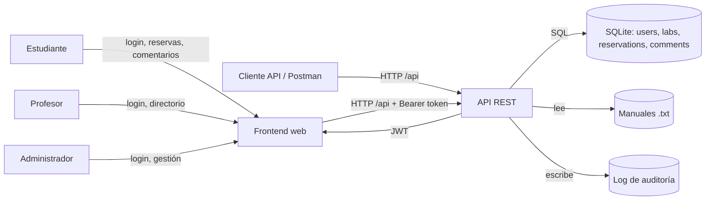

# Parte A — Modelado de amenazas de LabReserva

> Documento construido a partir del README y de la aplicación en ejecución. Las hipótesis se plantearon antes de revisar el código; la columna **Confirmada** se completó después, durante la cacería de la Parte B.

## 1. ¿Qué estamos construyendo?

LabReserva es un sistema web para reservar los laboratorios de la escuela. Tiene un frontend estático y una API REST. Los actores son:

- **Estudiante:** consulta laboratorios, comenta, crea y cancela sus propias reservas y edita su perfil.
- **Profesor:** hace lo mismo que un estudiante y además consulta el directorio de usuarios.
- **Administrador:** crea laboratorios, consulta todas las reservas y elimina usuarios.
- **Cliente API:** Postman, `requests.http` o cualquier script con un token válido.
- **Sistema de archivos:** guarda los manuales `.txt` que descarga `/api/files`.
- **Base de datos SQLite:** guarda usuarios, laboratorios, reservas y comentarios.
- **Log de auditoría:** registra eventos de seguridad y operación.

### DFD de nivel 1

**Fronteras de confianza:**

1. Navegador del usuario ↔ frontend/API.
2. API ↔ base de datos.
3. API ↔ sistema de archivos de manuales.
4. API ↔ log de auditoría.
5. Estudiante/profesor ↔ funciones de administrador.

**Flujos principales:**

- Registro y login: credenciales → API → base de datos → token JWT.
- Consulta de laboratorios y comentarios: frontend/API → base de datos.
- Reservas: token → API → validación de disponibilidad → base de datos.
- Manuales: API → sistema de archivos → respuesta de texto.
- Administración: token de admin → API → operaciones sobre laboratorios, reservas y usuarios.
- Auditoría: API → log de eventos de seguridad.

## 2. ¿Qué puede salir mal? Hipótesis STRIDE

| ID | STRIDE | Hipótesis | Activo afectado | Confirmada |
|---|---|---|---|---|
| H01 | Spoofing | Un atacante podría falsificar un JWT si el secreto es débil o se filtra. | Identidad y sesión | F01, F02, F22 |
| H02 | Spoofing | Se podría adivinar una contraseña por fuerza bruta si el login no tiene límite de intentos. | Cuentas de usuario | F13 |
| H03 | Spoofing | Un XSS podría robar el token guardado en el navegador y suplantar al usuario. | Sesión del usuario | F10 |
| H04 | Tampering | El cliente podría enviar `role: "admin"` en el perfil y escalar privilegios por mass assignment. | Autorización | F05 |
| H05 | Tampering | Un término de búsqueda podría modificar la consulta SQL y extraer datos de otras tablas. | Base de datos | F06 |
| H06 | Tampering | Un comentario con HTML/JavaScript podría ejecutarse en el navegador de otro usuario. | Integridad del frontend | F10 |
| H07 | Repudiation | Sin logs, un usuario podría negar un login, una cancelación o un borrado. | No repudio | F21 |
| H08 | Information disclosure | Una ruta de depuración podría exponer la configuración y el `JWT_SECRET`. | Secretos | F01 |
| H09 | Information disclosure | El directorio de usuarios podría devolver `password_hash` a un estudiante. | Credenciales | F08 |
| H10 | Information disclosure | Un IDOR podría permitir leer reservas de otros usuarios. | Datos personales | F04 |
| H11 | Information disclosure | Los errores podrían devolver stack traces, rutas y mensajes internos. | Detalles internos | F14 |
| H12 | Information disclosure | Un CORS demasiado abierto podría permitir que un origen malicioso use la sesión del navegador. | Sesión y datos | F16 |
| H13 | Denial of service | Un body gigante o muchas solicitudes podrían agotar memoria o CPU. | Disponibilidad | F15, F13 |
| H14 | Denial of service | El login sin rate limit podría saturar el servidor con intentos y hashes costosos. | Disponibilidad | F13 |
| H15 | Elevation of privilege | Un estudiante podría llegar a rutas de administrador si falta una verificación de rol. | Autorización | F03 |
| H16 | Elevation of privilege | Un path traversal podría leer archivos fuera del directorio de manuales, como `.env`. | Secretos y archivos | F07 |
| H17 | Elevation of privilege | El rol podría tomarse del token en lugar de la base de datos, permitiendo una escalada si el token se forja. | Autorización | F22 |
| H18 | Information disclosure | Las contraseñas podrían estar hasheadas con MD5 sin sal y ser crackeables. | Credenciales | F09 |
| H19 | Tampering | La falta de validación estricta podría aceptar fechas, horas o tipos inválidos en las reservas. | Integridad de datos | F18 |
| H20 | Tampering | Una dependencia vulnerable podría introducir código malicioso o CVEs conocidos. | Cadena de suministro | F19 |

## 3. ¿Qué vamos a hacer? Priorización del riesgo

| Riesgo | Probabilidad | Impacto | Estrategia | Control aplicado | Capa |
|---|---|---|---|---|---|
| F01 · Configuración filtrada | Alta | Alto | Eliminar | Se eliminó `/api/debug/config` | Configuración |
| F02 · JWT forjable | Alta | Alto | Mitigar | Secreto obligatorio, HS256 fijo, expiración de 15 min | Identidad/sesión |
| F03 · Estudiante en `/admin` | Alta | Alto | Mitigar | `requireAuth` + `requireAdmin` en todo `/admin` | Autorización |
| F04 · IDOR en reservas | Alta | Alto | Mitigar | Filtro por dueño en el repositorio | Datos/autorización |
| F05 · Mass assignment | Alta | Alto | Mitigar | Schema estricto y lista blanca de campos | Entrada/datos |
| F06 · SQL injection | Alta | Alto | Mitigar | Consultas parametrizadas | Datos |
| F07 · Path traversal | Media | Alto | Mitigar | Lista blanca de nombres y verificación de ruta | Archivos |
| F08 · Hashes en el directorio | Alta | Alto | Mitigar | Solo profesor/admin y columnas públicas | Autorización/datos |
| F09 · MD5 sin sal | Alta | Alto | Mitigar | scrypt con sal y comparación en tiempo constante | Criptografía |
| F10 · XSS y token en `localStorage` | Alta | Alto | Mitigar | Escape de salida, CSP y token en memoria | Frontend/sesión |
| F11 · Enumeración de usuarios | Media | Medio | Mitigar | Respuesta uniforme y hash falso | Autenticación |
| F12 · Credenciales en logs | Media | Alto | Eliminar | No registrar el body del login | Operación/logs |
| F13 · Fuerza bruta | Alta | Alto | Mitigar | Rate limit por IP+email, por IP y general | Operación |
| F14 · Stack traces | Alta | Medio | Mitigar | Manejador de errores genérico | Operación/errores |
| F15 · Body gigante | Media | Medio | Mitigar | Límite de 10 KB | Configuración |
| F16 · CORS abierto | Media | Alto | Mitigar | CORS restringido a `CORS_ORIGINS` | Configuración |
| F17 · Cabeceras ausentes | Alta | Medio | Mitigar | helmet con CSP, HSTS, nosniff y anti-clickjacking | Configuración |
| F18 · Validación débil | Alta | Alto | Mitigar | Schemas estrictos con zod | Entrada |
| F19 · Dependencia vulnerable | Media | Alto | Eliminar | Se eliminó `lodash 4.17.20` | Cadena de suministro |
| F20 · `.env` en git | Alta | Alto | Eliminar/mitigar | `.env` fuera de git y rotación del secreto | Secretos/operación |
| F21 · Sin auditoría | Media | Medio | Mitigar | `src/lib/audit.js` y eventos de seguridad | Operación/logs |
| F22 · Rol desde el token | Alta | Alto | Mitigar | Usuario y rol se leen de la base de datos | Identidad/autorización |

**Riesgos aceptados:**

- Token en memoria sin refresh token: el usuario debe volver a iniciar sesión al recargar y cada 15 minutos. Riesgo aceptado en `docs/adr/ADR-001-token-en-memoria.md`.
- SQLite en memoria: los datos se pierden al reiniciar; es adecuado para la actividad, no para producción.
- Rate limiting en memoria: se reinicia con el servidor y no se comparte entre instancias; para producción se recomienda Redis.

## 4. ¿Hicimos un buen trabajo?

- La batería `npm run attacks` reporta **0 ataques exitosos** y **24 de 24 bloqueados**.
- `npm audit` reporta **0 vulnerabilidades** en las dependencias instaladas.
- Todos los archivos `.js` y `.mjs` pasan `node --check`.
- Los riesgos residuales están documentados en `INFORME_AUDITORIA.md`.
- Cada hallazgo tiene un commit propio y una verificación en `PARTE_B_HALLAZGOS.md`.

## 5. Respuestas a las tres preguntas de diseño

| Diseño / control | ¿Quién puede hacer qué, y dónde se revisa? | ¿Qué pasa si este control falla? | ¿Cómo me entero de que me están atacando? |
|---|---|---|---|
| Autenticación y login | Cualquier visitante puede registrarse o iniciar sesión. Se revisa en `auth.routes.js`, con validación zod y rate limit. | Suplantación, fuerza bruta o enumeración de cuentas (F02, F11, F13). | Eventos `login_fallido` y `login_ok` en el log de auditoría; respuestas `429`; alertas por picos de intentos. |
| Sesión y JWT | El cliente presenta un Bearer token. Se verifica firma, algoritmo, expiración y usuario real en `requireAuth`. | Token robado o forjado, o rol obsoleto (F02, F10, F22). | Eventos `token_invalido` y `token_de_usuario_inexistente`; respuestas `401`; re-login obligatorio. |
| Autorización por rol | Estudiante, profesor y admin tienen permisos distintos. Se revisa en `requireRole` y `requireAdmin`, a nivel de router. | Escalada de privilegios y acceso a `/admin` (F03, F05, F22). | Eventos `acceso_denegado`; respuestas `403`; revisión de acciones administrativas. |
| Propiedad de recursos | Cada usuario solo puede leer y cancelar sus reservas. Se revisa en `reservations.repository.js` con el `user_id` del token. | IDOR: lectura o cancelación de reservas ajenas (F04). | Eventos `reserva_ajena_o_inexistente` y `cancelacion_denegada`; respuestas `404`. |
| Entrada y datos | Todos los clientes envían datos. Se validan con zod en el servidor y se usan consultas parametrizadas. | Mass assignment, SQL injection, XSS o datos inválidos (F05, F06, F10, F18). | Respuestas `400`; logs de validación; CSP; auditoría de acciones. |
| Archivos y secretos | Cualquier visitante puede listar/descargar manuales. Se revisa con lista blanca y `path.resolve`; los secretos viven en `.env`. | Path traversal o filtración de secretos (F01, F07, F20). | Respuestas `400`; escaneo de secretos en git; rotación de llaves; logs de acceso. |
| Configuración y cadena de suministro | Los operadores configuran CORS, límites y dependencias. Se revisa con helmet, `CORS_ORIGINS`, límite de body, lockfile y `npm audit`. | XSS, clickjacking, DoS, CORS abierto o dependencias vulnerables (F15–F17, F19). | Cabeceras de seguridad; `npm audit`; logs de `413` y `429`; alertas de dependencias. |
| Operación, errores y auditoría | Los operadores revisan logs y errores. Se revisa en `audit.js` y `error-handler.js`. | Sin no repudio ni detección; filtración de stack traces (F14, F21). | Logs centralizados; alertas por `login_fallido`, `acceso_denegado` y `usuario_eliminado`; revisión de errores `500`. |
